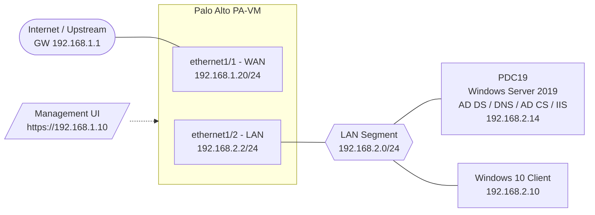

[README.md](https://github.com/user-attachments/files/35403891/README.md)
# Palo Alto PA-VM Firewall Lab (WAN / LAN with Active Directory & DNS)

A virtual lab that places a **Palo Alto Networks VM-Series (PA-VM)** firewall between an upstream network (WAN) and an internal network (LAN) hosting a **Windows Server 2019 Domain Controller** and a **Windows 10 client**. It demonstrates a complete Layer 3 deployment: interfaces and zones, default routing, service routes, source NAT, a security policy, and verified internet access from the internal client.

---

## Table of Contents

1. [Objectives](#objectives)
2. [Topology](#topology)
3. [Lab Environment](#lab-environment)
4. [IP Addressing Plan](#ip-addressing-plan)
5. [Configuration Walkthrough](#configuration-walkthrough)
   - [1. Interfaces](#1-interfaces)
   - [2. Security Zones](#2-security-zones)
   - [3. Virtual Router & Default Route](#3-virtual-router--default-route)
   - [4. Service Routes (DNS / LDAP)](#4-service-routes-dns--ldap)
   - [5. NAT Policy](#5-nat-policy)
   - [6. Security Policy](#6-security-policy)
   - [7. Windows Server 2019 (PDC19)](#7-windows-server-2019-pdc19)
   - [8. Windows 10 Client](#8-windows-10-client)
6. [Verification](#verification)
7. [Traffic Flow](#traffic-flow)
8. [Security Notes & Hardening Ideas](#security-notes--hardening-ideas)
9. [Troubleshooting](#troubleshooting)
10. [Repository Structure](#repository-structure)
11. [Author](#author)

---

## Objectives

- Deploy a PA-VM firewall as a Layer 3 gateway for an internal subnet.
- Separate the network into **WAN** (untrusted) and **LAN** (trusted) security zones.
- Configure a **default static route** toward the upstream gateway.
- Configure **service routes** so firewall-originated DNS and LDAP traffic leaves from the LAN interface.
- Configure **source NAT** (dynamic IP and port) and a **security rule** allowing LAN → WAN traffic.
- Host **Active Directory, DNS, AD CS and IIS** on Windows Server 2019 inside the LAN.
- Verify end-to-end connectivity and DNS resolution from a Windows 10 client.

---

## Topology



---

## Lab Environment

| Component | Details |
|---|---|
| Hypervisor | VMware |
| Firewall | Palo Alto Networks **PA-VM** (VM-Series), image `PA-VM-ESX-10.0.0` |
| Domain Controller | Windows Server 2019 — hostname `PDC19`, domain `test.local` |
| Server roles | AD DS, DNS, AD CS, IIS, File and Storage Services |
| Client | Windows 10 (build 10.0.18363) |
| Client tools | PRTG Network Monitor, Wireshark |

---

## IP Addressing Plan

| Device | Interface | IP Address | Subnet Mask | Gateway | DNS |
|---|---|---|---|---|---|
| Upstream router | — | 192.168.1.1 | /24 | — | — |
| PA-VM (management) | MGMT | 192.168.1.10 | /24 | — | — |
| PA-VM | `ethernet1/1` (WAN) | 192.168.1.20 | 255.255.255.0 | 192.168.1.1 | — |
| PA-VM | `ethernet1/2` (LAN) | 192.168.2.2 | 255.255.255.0 | — | — |
| PDC19 (Windows Server 2019) | Ethernet1 | 192.168.2.14 | 255.255.255.0 | 192.168.2.2 | 127.0.0.1 (pref.), 8.8.8.8 (alt.) |
| Windows 10 client | Ethernet0 | 192.168.2.10 | 255.255.255.0 | 192.168.2.2 | 192.168.2.14 |

---

## Configuration Walkthrough

### 1. Interfaces

**Path:** `Network → Interfaces → Ethernet`

| Interface | Type | IP Address | Virtual Router | Security Zone | Mgmt Profile |
|---|---|---|---|---|---|
| `ethernet1/1` | Layer3 | 192.168.1.20/24 | default | **WAN** | — |
| `ethernet1/2` | Layer3 | 192.168.2.2/24 | default | **LAN** | `pro` |
| `ethernet1/3` – `ethernet1/9` | Unconfigured | — | — | — | — |

Both configured interfaces show link state **up**.


### 2. Security Zones

**Path:** `Network → Zones`

| Zone | Type | Interface |
|---|---|---|
| **LAN** | Layer3 | `ethernet1/2` |
| **WAN** | Layer3 | `ethernet1/1` |


### 3. Virtual Router & Default Route

**Path:** `Network → Virtual Routers → default → Static Routes`

| Parameter | Value |
|---|---|
| Name | `VR` |
| Destination | `0.0.0.0/0` |
| Interface | `ethernet1/1` |
| Next Hop | IP Address → `192.168.1.1` |
| Metric | 10 |
| Route Table | Unicast |
| BFD Profile | Disable BFD |
| Path Monitoring | Disabled |


### 4. Service Routes (DNS / LDAP)

**Path:** `Device → Setup → Services`

| Setting | Value |
|---|---|
| Primary DNS Server | `8.8.8.8` |
| Secondary DNS Server | `192.168.2.x` (internal DC) |

**Service Route Configuration** is set to **Customize**:

| Service | Source Interface | Source Address |
|---|---|---|
| DNS | `ethernet1/2` | `192.168.2.2/24` |
| LDAP | `ethernet1/2` | `192.168.2.2/24` |
| All other services | Use default | Use default |

This makes the firewall reach the internal domain controller (DNS/LDAP) from its LAN address.


### 5. NAT Policy

**Path:** `Policies → NAT`

| Field | Value |
|---|---|
| Name | `NAT` |
| Source Zone | LAN |
| Destination Zone | WAN |
| Destination Interface | `ethernet1/1` |
| Source Address | `192.168.2.10`, `192.168.2.14` |
| Destination Address | any |
| Service | any |
| Source Translation | **Dynamic IP and Port** → interface `ethernet1/1` (`192.168.1.20/24`) |
| Destination Translation | none |

The client and the domain controller are translated to the firewall's WAN address when going out. Other LAN hosts are not covered by this rule.


### 6. Security Policy

**Path:** `Policies → Security`

| # | Name | Type | Source Zone | Destination Zone | Application | Service | Action |
|---|---|---|---|---|---|---|---|
| 1 | `Internet` | universal | LAN | WAN | any | any | **Allow** |
| 2 | `intrazone-default` | intrazone | any | (intrazone) | any | any | Allow |
| 3 | `interzone-default` | interzone | any | any | any | any | **Deny** |

Rule 1 allows everything from LAN to WAN. Rules 2 and 3 are the PAN-OS default rules: traffic inside a zone is allowed, and any other traffic between zones (for example WAN → LAN) is denied.


### 7. Windows Server 2019 (PDC19)

| Setting | Value |
|---|---|
| Computer name | `PDC19` |
| Domain | `test.local` |
| IPv4 address | `192.168.2.14 / 255.255.255.0` |
| Default gateway | `192.168.2.2` (PA-VM LAN interface) |
| Preferred DNS | `127.0.0.1` |
| Alternate DNS | `8.8.8.8` |
| Windows Defender Firewall | Domain profile: Off |
| Remote Management / Remote Desktop | Enabled |
| Time zone | (UTC+02:00) Cairo |
| Installed roles | AD DS, AD CS, DNS, IIS, File and Storage Services |


### 8. Windows 10 Client

| Setting | Value |
|---|---|
| IPv4 address | `192.168.2.10 / 255.255.255.0` |
| Default gateway | `192.168.2.2` |
| Preferred DNS | `192.168.2.14` (PDC19) |


---

## Verification

From the Windows 10 client:

```cmd
ping 8.8.8.8
ping google.com
```

| Test | Result |
|---|---|
| `ping 8.8.8.8` | Replies received, ~46–49 ms, TTL 117, **0% loss** |
| `ping google.com` | Resolved to `142.250.181.142`, ~47–48 ms, TTL 116, **0% loss** |

This confirms the client reaches the internet through the firewall, the NAT and security rules work, and DNS resolution through the internal DNS server works.


---

## Traffic Flow

1. The client (`192.168.2.10`) sends traffic to its gateway `192.168.2.2` (**LAN**, `ethernet1/2`).
2. For names, the client queries `192.168.2.14` (PDC19), which resolves external names.
3. The route lookup selects the default route `0.0.0.0/0` via `ethernet1/1` (**WAN**).
4. The **Security rule `Internet`** (LAN → WAN) allows the session.
5. The **NAT rule** translates the source to `192.168.1.20` (dynamic IP and port) and the packet leaves toward `192.168.1.1`.
6. Return traffic matches the existing session, is translated back, and reaches the client.

---

## Security Notes & Hardening Ideas

> This is a lab. The points below are suggestions for going further.

- **Security rule:** `Internet` allows `any` application and `any` service. Replace it with App-ID based rules and attach Threat Prevention / URL Filtering / Logging profiles. The Policy Optimizer already flags it under *No App Specified*.
- **Management access:** the web UI is reached over a connection flagged "Not secure". Install a trusted certificate and restrict management to trusted IPs.
- **Windows Firewall is off** on the domain profile of PDC19. Re-enable it and allow only required ports (DNS 53, LDAP 389/636, Kerberos 88, SMB 445, RDP 3389 from admin hosts only).
- **Zone Protection / Log Forwarding:** zones have no Zone Protection Profile or Log Setting yet.
- **NAT scope:** the NAT rule only matches `192.168.2.10` and `192.168.2.14`; use `192.168.2.0/24` to cover the whole LAN.
- **DNS:** keep the DC as primary resolver with a forwarder, and avoid public DNS as a secondary on domain-joined machines.
- **Never commit** credentials, license/auth codes, or exported configs containing password hashes.

---

## Troubleshooting

| Symptom | Things to check |
|---|---|
| Client can't ping the gateway | VM network adapter mapping, `ethernet1/2` link state, management profile allows ping |
| Gateway reachable but no internet | Default route and next hop, Security rule LAN → WAN, NAT rule source addresses, upstream gateway reachable |
| IP works but names don't resolve | Client DNS (`192.168.2.14`), DNS service on PDC19, forwarders |
| Config changes not applied | Click **Commit** in the PA-VM web UI |
| Firewall can't reach DNS/LDAP | Service Route source interface/address under `Device → Setup → Services` |

Useful PAN-OS CLI commands:

```text
show interface all
show routing route
test routing fib-lookup virtual-router default ip 8.8.8.8
show session all filter source 192.168.2.10
show running nat-policy
show running security-policy
```

---

## Repository Structure

```text
palo-alto-pa-vm-lab/
├── README.md
├── .gitignore
└── images/
    ├── 01-interfaces.png
    ├── 02-zones.png
    ├── 03-static-route.png
    ├── 04-service-routes.png
    ├── 05-nat-policy.png
    ├── 06-security-policy.png
    ├── 07-server-ip.png
    ├── 08-client-ip.png
    └── 09-ping-test.png
```

---

## Author

**Mohamed**
Computer Science / Engineering student — networking & network security (Blue Team).

Suggestions and pull requests are welcome.
